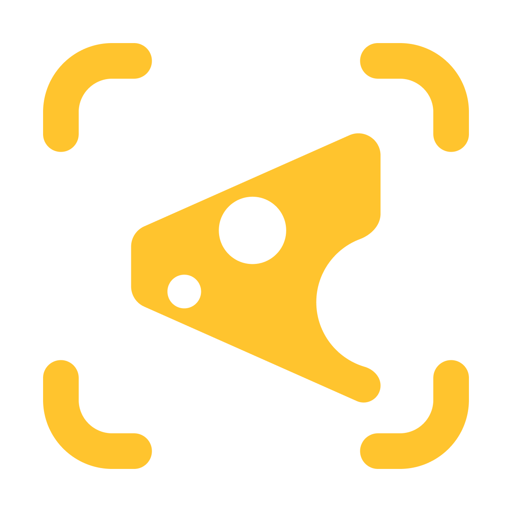

# Queijo



Ferramenta de captura de tela, gravação de vídeo e GIF para o GNOME, no Linux.

Aperte um atalho e todos os monitores escurecem, mas você continua vendo a tela
ao vivo. Arraste sobre o que quer, faça anotações e copie ou salve: o resultado
é a tela como estava no instante em que você apertou o atalho. Troque para vídeo ou GIF para gravar a
mesma seleção.

## Idiomas

| Idioma | |
| --- | --- |
| English | [README.md](README.md) |
| Português (Brasil) | esta página |

O programa também está nesses idiomas e acompanha o idioma do sistema; dá para
escolher outro em **Configurações → Geral → Idioma**. Mais idiomas estão
previstos; o passo a passo para adicionar um está em
[docs/TRANSLATING.md](docs/TRANSLATING.md) (em inglês).

## Recursos

- **Escurece e seleciona** em todos os monitores ao mesmo tempo. A seleção pode
  atravessar monitores.
- **Três formas de capturar**: uma área qualquer, uma tela inteira ou uma janela.
  Com a extensão do GNOME Shell, o modo janela lista todas as janelas com uma
  prévia ao vivo.
- **Anotações**: caneta, linha, seta, retângulo, elipse, marca-texto, texto e
  pixelar, com desfazer/refazer, cores e tamanhos. `Shift` mantém ângulos e
  formas retos.
- **Gravação de vídeo** em WebM e **GIF animado**, com contagem regressiva,
  ponteiro do mouse opcional e um indicador de gravação na barra superior. Os
  GIFs são gravados sem perdas e depois otimizados (uma paleta por clipe,
  pontilhado leve, só a parte que muda em cada quadro).
- **Janela de configurações**: atalhos globais, pasta e modelo de nome por
  formato, PNG ou JPEG, opções de gravação e idioma.

## Compatibilidade

O Queijo foi feito para o **GNOME**. Só foi testado no **Ubuntu 22.04 com GNOME 42
no Wayland**, que é o ambiente para o qual os pacotes são gerados. Outras versões
do GNOME, sessões X11 e outros ambientes de desktop não foram testados. Fora do
GNOME não há gravação de tela, e as capturas de imagem só funcionam pelos
recursos alternativos (`gnome-screenshot` ou `grim`). `queijo --doctor` mostra o que
foi detectado no seu sistema; inclua a saída dele ao relatar um problema.

## Instalação

Baixe os arquivos na página de **Releases**.

### Ubuntu 22.04 (`.deb`)

```sh
sudo apt install ./queijo_<versão>-1_amd64.deb
```

O `apt` também instala o que o Queijo precisa (`ffmpeg`, `wl-clipboard`
e algumas bibliotecas).

### Outras instalações (`.tar.gz`)

```sh
tar xzf queijo-<versão>-x86_64-linux.tar.gz
cd queijo-<versão>-x86_64-linux
./install.sh                          # só para você (~/.local)
sudo PREFIX=/usr/local ./install.sh   # para todos
./install.sh --uninstall              # remove de novo
```

É preciso ter `ffmpeg` e `wl-clipboard` (Wayland) instalados. O `gifsicle` deixa
os GIFs um pouco menores, e o `zenity` (ou `kdialog`) e o `libnotify-bin` só são
usados quando o seletor de pastas e as notificações do próprio desktop não existem.

### Extensão do GNOME Shell (opcional)

No GNOME só o Shell enxerga quais janelas existem, então uma pequena extensão
fornece o seletor de janelas e o indicador de gravação na barra superior. O
`.deb` e o `.tar.gz` já a incluem; ative e saia e entre de novo na sessão (no
Wayland o Shell só carrega extensões novas no login):

```sh
gnome-extensions enable queijo@queijo.app
```

Ela também sai sozinha como `queijo-gnome-extension-<versão>.zip`
(`gnome-extensions install <arquivo>`). Sem ela, o modo janela captura a janela
que estava ativa quando o Queijo abriu, e as gravações são paradas pelo atalho.

## Uso

Associe o `queijo` a uma tecla (por exemplo `Print Screen`) em **Configurações →
Atalhos**, ou nas configurações de teclado do próprio GNOME, e aperte.

A barra no topo muda o que você captura:

| Tecla | |
| --- | --- |
| `S` | **Área**: arraste qualquer região (o padrão) |
| `C` | **Tela**: clique em um monitor |
| `W` | **Janela**: clique em uma janela |
| `V` | **Imagem** ⇄ **gravação de vídeo** |
| `G` | **GIF animado** |
| `P` | Mostrar o ponteiro do mouse na captura |

Essas teclas funcionam antes de selecionar algo.

| Tecla | Ação |
| --- | --- |
| Arrastar | Seleciona uma área; arraste por dentro para mover, pelas alças e bordas para redimensionar |
| `Ctrl+A` | Seleciona a tela inteira |
| `Ctrl+C` / `Enter` | Copia e fecha (`Enter` inicia a gravação nos modos vídeo e GIF) |
| `Ctrl+S` | Salva e fecha |
| `Esc` | Fecha |
| `P` `L` `A` `R` `E` `M` `T` `B` | Caneta, linha, seta, retângulo, elipse, marca-texto, texto, pixelar (com uma área selecionada) |
| Roda do mouse | Tamanho da ferramenta atual |
| `Shift` ao desenhar | Linhas de 45°, quadrados, círculos e traços retos do marca-texto |
| `Ctrl+Z` / `Ctrl+Shift+Z` | Desfazer / refazer |
| Setas | Move a seleção (`Shift` = 10 px) |

### Gravação

No modo vídeo ou GIF, escolha a área e aperte **Gravar** (ou `Enter`). Uma contagem
regressiva mostra como parar, e então o Queijo sai da frente e grava em segundo
plano. Para parar, aperte o atalho do Queijo de novo, clique no indicador da barra
superior (com a extensão) ou use `queijo --stop`. `Esc` durante a contagem cancela.

Os vídeos são WebM; os GIFs são salvos e também copiados para a área de
transferência. Os dois vão para `~/Videos/Screencasts`, a menos que você mude a
pasta.

### Linha de comando

```sh
queijo                  # abre o editor
queijo --quick          # salva a área de trabalho inteira, sem o editor
queijo --kind gif       # abre no modo GIF (também: photo, video)
queijo --area window    # abre no modo janela (também: selection, screen)
queijo -m eDP-1         # usa só um monitor (veja --list-monitors)
queijo -d 3             # espera 3 segundos antes
queijo -o ~/Capturas    # salva as imagens nessa pasta desta vez
queijo --stop           # para uma gravação
queijo --settings       # abre as configurações
queijo --doctor         # o que o Queijo encontrou no seu sistema e o que falta
```

As opções da linha de comando e a ajuda (`--help`) estão em inglês.

## Configurações

Abra pela engrenagem na barra superior do editor, com `queijo --settings` ou em
**Configurações do Queijo** no menu de aplicativos. As mudanças valem na hora.

- **Geral**: modo e captura iniciais, ponteiro ligado por padrão, notificações,
  "Ctrl+C também salva um arquivo", "Ctrl+S também copia", idioma.
- **Atalhos**: atalhos globais para abrir o Queijo, abrir direto em vídeo ou GIF e
  salvar a tela inteira sem o editor. Até duas teclas cada; clique em um campo e
  aperte as teclas. Os atalhos de captura do próprio GNOME na mesma tecla são
  desligados, e conflitos com seus outros atalhos são avisados.
- **Arquivos**: pasta e modelo de nome para imagens, vídeos e GIFs, e PNG ou JPEG.
  Marcadores: `{date}` `{time}` `{year}` `{month}` `{day}` `{hour}` `{minute}`
  `{second}` `{width}` `{height}` `{timestamp}`. Arquivos existentes nunca são
  sobrescritos.
- **Gravação**: contagem regressiva, quadros por segundo do vídeo e do GIF e
  largura máxima do GIF.
- **Editor**: lembrar a última cor e os tamanhos das ferramentas, cor inicial,
  restaurar o padrão.

Ficam guardadas em `~/.config/queijo/config.toml`.

## Compilar o código

É preciso uma versão estável recente do Rust.

```sh
cargo build --release
cargo test
```

Os pacotes instaláveis são gerados com `scripts/build-packages.sh` (precisa de
`cargo-deb` e `zip`). Como uma versão é publicada está em
[docs/RELEASING.md](docs/RELEASING.md) (em inglês).

## Licença

[MIT](LICENSE)
